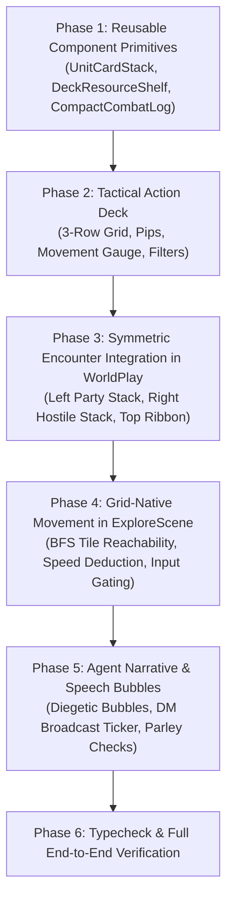

# Seven CRPG Play View HUD — Implementation Plan

## Executive Summary & Design Vision
This plan establishes the engineering architecture for the Play View HUD redesign in Seven. The design combines the data density, spatial discipline, and configurable deck architecture of modern CRPGs (Baldur's Gate 3, Pathfinder: Wrath of the Righteous) with Seven's signature **Cyberpunk meets MCRN (Martian Congressional Republic Navy) terminal aesthetic**: utilitarian, high-density telemetry, sharp 0px geometry, scanline filtering, and crisp monospace telemetry.

---

## 1. Key Discoveries from Prototyping & Plan Revisions

Through iterative prototyping and mockup validation, five critical architectural principles were established that supersede previous plans:

1. **The Single 1x9 Action Bar Was a Web UI Failure**:
   * *Discovery*: A single 1-row, 9-slot action bar cannot scale to a hybrid RPG where an agentic character possesses meta actions (Parley/Negotiate), character maneuvers (Dash, Dodge, Disengage, Hide), class abilities/spells, and inventory consumables.
   * *Revision*: Replaced with a **dense 3-row configurable tactical deck** with adjustable section dividers and bottom category filter tabs (`[ALL]`, `[COMMON]`, `[CLASS]`, `[ITEMS]`, `[META]`).

2. **Resource Telemetry Belongs on the Action Bar Shelf**:
   * *Discovery*: Floating action economy badges and speed text across the viewport caused visual clutter and layout collisions.
   * *Revision*: The top shelf of the action dock directly integrates:
     * Resource pips: Action (`●`), Bonus Action (`▲`), Reaction (`■`).
     * Class charges: Infusions / Ki / Sorcery (`⚡ 3/3`).
     * Spell Slot Matrix: Roman numeral pips (`I [■ ■]`, `II [■]`).
     * Continuous movement gauge (`30/30 FT`).

3. **Target Telemetry Belongs in a Symmetrical Right-Edge Encounter Stack**:
   * *Discovery*: Anchoring target frames to the top header or floating under the initiative strip caused immediate overlaps and prevented multi-target encounter management.
   * *Revision*: The right edge now mirrors the allied party stack on the left. The `EncounterUnitStack` handles multi-enemy battles (e.g. Dire Wolf Alpha, Timber Wolf 2), allowing players to select targets with one click.

4. **Mechanical Roll Logs Must Be Passive and Unobtrusive**:
   * *Discovery*: Floating roll theater cards collided with narrative text and distracted from the combat map.
   * *Revision*: The mechanical d20 roll log is tucked into a compact 1-line ticker pill at `bottom-3 right-3`. It remains quiet and unobtrusive unless explicitly expanded by the player.

5. **Generative Agent Interaction Requires Two Distinct Channels**:
   * *Discovery*: Blending DM narration and character speech into a single chat window breaks immersion during battle.
   * *Revision*:
     * **In-World Diegetic Speech Bubbles**: Rendered directly over character and monster tokens on the map canvas for tactical barks, spell incantations, and reaction cries.
     * **Cinematic DM Broadcast Banner**: A subtle, non-blocking subtitle stream docked under the top bar for descriptive narrative prose.

---

## 2. Reusable Component Architecture

To prevent one-off hardcoded components, the HUD is broken into modular, reusable primitives located in `src/renderer/src/components/play/hud/` and `src/renderer/src/game/ui/`:

### A. `EncounterUnitStack` (`UnitCardStack.tsx`)
* **Purpose**: Renders vertical stacks of unit cards.
* **Reusability**:
  * Used on the **Left Edge** for allied party members (`allies: PlaceVisitor[]`).
  * Used on the **Right Edge** for hostile encounter combatants (`hostiles: Combatant[]`).
* **Props**:
  * `units: UnitSummary[]` (id, name, initials, level/cr, hpCur, hpMax, ac, active, statusPips).
  * `side: 'left' | 'right'`.
  * `accentColor: 'cyan' | 'red' | 'amber'`.
  * `onSelect: (id: string) => void`.
* **Styling**: MCRN terminal unit frame, 1px border (`var(--line)` or red), mini HP bar, active state indicator.

### B. `TacticalActionDeck` (`TacticalActionDeck.tsx`)
* **Purpose**: Dense 3-row configurable tactical grid replacing the legacy 1x9 `ActionBarHud` and dummy `TacticalCombatDock`.
* **Sub-components**:
  * `DeckResourceShelf`: Houses Action/Bonus/Reaction pips, class resource charges, Roman numeral spell slot matrix, and continuous movement meter.
  * `DeckGrid`: 3-row slot container supporting drag-and-drop slottable abilities, weapons, spells, and items.
  * `DeckDivider`: Visual resizable divider separating utility maneuvers, combat attacks, and items.
  * `DeckFilterBar`: Terminal-style category tabs (`[ALL]`, `[COMMON]`, `[CLASS]`, `[ITEMS]`, `[META]`).
  * `EndTurnButton`: Compact MCRN terminal button with hotkey indicator (`[SPACE]`).
* **Props**:
  * `visitor: PlaceVisitor | null`.
  * `catalog?: Catalog | null`.
  * `economy: TurnEconomy`.
  * `onExecuteAction: (actionId: string) => void`.
  * `onEndTurn: () => void`.

### C. `InitiativeRibbon` (`InitiativeRibbon.tsx`)
* **Purpose**: Pure visual turn sequencer mounted at the top-center.
* **Props**:
  * `round: number`.
  * `combatants: Combatant[]`.
  * `activeCombatantId: string`.
  * `onSelectCombatant: (id: string) => void`.
* **Styling**: Compact 28px height, avatar queue with faction-colored indicator rings.

### D. `AgentNarrationStream` (`AgentNarrationStream.tsx`)
* **Purpose**: Cinematic DM narrative subtitle ticker.
* **Props**:
  * `latestNarration: string | null`.
  * `speaker?: string`.
  * `faded: boolean`.
* **Styling**: Dark scanline backdrop, 1px amber border, smooth auto-fade timer (4s) on new entries.

### E. `DiegeticSpeechOverlay` (`DiegeticSpeechOverlay.tsx`)
* **Purpose**: Coordinates in-world speech bubbles positioned above 2D map tokens using camera view projections.
* **Props**:
  * `bubbles: SpeechBubbleEvent[]`.
  * `camera: View`.

### F. `CompactCombatLog` (`CompactCombatLog.tsx`)
* **Purpose**: Unobtrusive combat log drawer in the bottom-right corner.
* **Props**:
  * `logs: CombatLogEntry[]`.
  * `defaultExpanded?: boolean`.
* **Features**: 1-line ticker preview pill when collapsed; full roll breakdown drawer when expanded.

---

## 3. Cyberpunk meets MCRN Terminal Styling Specifications

All components must adhere strictly to Seven's visual language:

| Design Element | Specification | Seven Engine Class / Token |
| :--- | :--- | :--- |
| **Geometry** | Strictly zero rounded corners (`border-radius: 0px !important`). | Global override |
| **Surfaces** | Deep obsidian panel background (`rgba(8, 12, 18, 0.96)`). | `var(--color-sidebar)`, `var(--color-bg)` |
| **Borders** | Sharp 1px borders with MCRN amber and cyan accents. | `border-line`, `border-cyan/60`, `border-alert/70` |
| **Typography** | Utilitarian monospace font for all numbers, coordinates, and codes. | `font-mono text-[10px]` / `text-[11px]` |
| **Telemetry Accents** | Emerald for Actions/HP (`#10b981`), Orange for Bonus (`#f97316`), Purple for Reactions (`#a855f7`), Sky for Spell Slots (`#38bdf8`), Cyan for Movement/Allies (`#66fcf1`), Red for Hostiles (`#ef4444`). | Seven color tokens |
| **Texture** | Subtle CRT scanline overlay on active panels. | `.scanlines` CSS class |
| **Slot Dimensions** | Dense 36x36px tactical grid slots with hotkey badge bottom-left, cost top-right, stack count bottom-right. | `.deck-slot` |

---

## 4. Phased Implementation Roadmap

### Phase 1: Reusable Component Primitives
* **1.1**: Create `src/renderer/src/components/play/hud/UnitCardStack.tsx` for symmetric left (party) and right (hostile) encounter stacks.
* **1.2**: Create `src/renderer/src/components/play/hud/CompactCombatLog.tsx` implementing the collapsible 1-line ticker pill.
* **1.3**: Create `src/renderer/src/components/play/hud/AgentNarrationStream.tsx` for the cinematic DM broadcast stream.

### Phase 2: Tactical Action Deck (CRPG Architecture)
* **2.1**: Refactor `src/renderer/src/components/play/hud/ActionBarHud.tsx` into `TacticalActionDeck.tsx`:
  * Integrate `DeckResourceShelf` (Action, Bonus, Reaction pips; spell slot matrix; infusion charges; movement meter).
  * Build the 3-row dense slot grid (`36x36px`) supporting character maneuvers, weapon strikes, spells, and consumables.
  * Implement bottom category filter tabs (`[ALL]`, `[COMMON]`, `[CLASS]`, `[ITEMS]`, `[META]`).
  * Include compact End Turn button (`[SPACE]`).
* **2.2**: Deprecate and remove `TacticalCombatDock.tsx`. Keep `TacticalActionDeck` mounted at all times.

### Phase 3: Symmetric Encounter Integration in `WorldPlay.tsx`
* **3.1**: In `WorldPlay.tsx`, mount `InitiativeRibbon` at the top bar (center).
* **3.2**: Mount `UnitCardStack` (side="left") for allied companions.
* **3.3**: Mount `UnitCardStack` (side="right") for hostile encounter combatants, mapping active battle combatants or spawned monsters.
* **3.4**: Connect clicking an enemy card to setting `who` / `attackTarget`.
* **3.5**: Delete disconnected `BattleArenaView` and the `MAP / ARENA` toggle button.

### Phase 4: Grid-Native Movement Enforcement in `ExploreScene.ts`
* **4.1**: Remove cosmetic overlays `drawCombatGrid` and `drawMovementRadius`.
* **4.2**: Implement BFS reachable tile calculation based on discrete map grid coordinates (`1 tile = 5 ft`) and `movementRemaining / 5`.
* **4.3**: Render discrete square tile highlights on walkable grid tiles.
* **4.4**: Enforce turn-based gating: block ground clicks if it is not the active player's turn or if speed budget is 0.
* **4.5**: Deduct traveled tiles (`tiles * 5`) from `movementRemaining` upon movement completion.

### Phase 5: Agent Narrative & Diegetic Speech Integration
* **5.1**: Connect combat action triggers (attack, spell cast, parley, damage taken) to `SpeechBubbleOverlay.tsx` to spawn in-world barks over tokens.
* **5.2**: Connect world events, critical hits, and DM responses to `AgentNarrationStream.tsx`.
* **5.3**: Wire the `Parley` deck button to trigger an opposed social check with the target agent, opening the dialogue drawer only on explicit execution.

### Phase 6: Verification & Quality Assurance
* **6.1**: Run `npm run typecheck:web` to ensure zero compilation or type errors.
* **6.2**: Verify that entering combat preserves the player's real abilities and inventory.
* **6.3**: Verify that multi-enemy encounters render symmetrically on the right edge without layout clipping.
* **6.4**: Verify that tile movement deducts speed in discrete 5 ft increments and locks when depleted.
