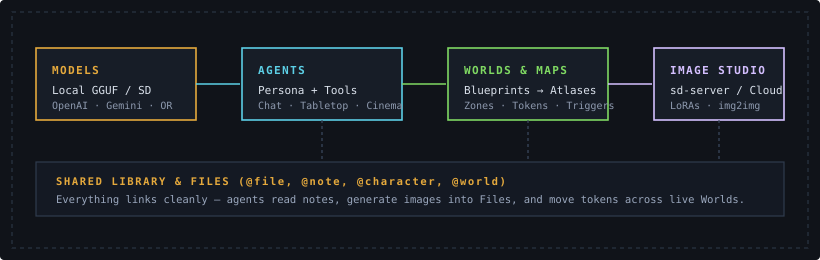

Seven is an all-in-one local-first studio for **AI agents**, **interactive worlds & maps**, **image generation**, and **linked notes & files**. These built-in guides live inside the app (separate from your editable Files and Agent docs) and focus on **practical ways to use Seven**.

## Core Workflows at a Glance

- **Chat & Roleplay:** Pair an agent with a local GGUF model or a cloud API (Google Gemini, OpenAI, Anthropic, OpenRouter) and switch between **Default**, **Tabletop**, and **Cinema** chat layouts. Open [Chat](seven-view:chat) or [Agents](seven-view:agents).
- **Image Studio:** Generate and edit pictures locally with `sd-server` (including LoRAs and companion weights) or remotely with OpenAI, Google Gemini, and OpenRouter image models. Open [Image Generator](seven-view:image).
- **Worlds & Map Blueprints:** Build reusable **Map Blueprints** (markers, zones, links) and instantiate them into live **Worlds** with tokens, spatial containment, and triggers. Open [Play / Worlds](seven-view:play) or [Data](seven-view:data).
- **Shared Library:** Reference anything inline using `@file`, `@note`, `@character`, or `@world` — agents can read linked descriptions and generate new assets directly into your library. Open [Files](seven-view:pages).

## Navigating Faster

### Bottom Taskbar & Quick Model Picker
- Click the **Model & Status** button in the bottom-right taskbar to load/unload a local model, star favourites, filter by family/quant/kind, or click the arrow icon on any row to jump straight to that model's detail page.
- Click the **magnifying glass** (`App Search`) to jump across chats, files, notes, and entries.

### Title Bar Activity Heartbeat
Whenever an agent turn, model load, or image generation is running, an ECG heartbeat sweeps across the entire title bar so you always know Seven is actively working — even when you switch views.

### Vault Encryption
If you store remote API keys (Google AI Studio, OpenAI, Anthropic, OpenRouter) or private chats, enable **Vault** in [Settings](seven-view:settings) to encrypt keys and personal data at rest.

## Where to Go Next

- Ready to connect a local GGUF or cloud key? Read [Models & Servers](guide:02-models-and-servers).
- Want agents to generate pictures automatically? Read [Image Generation & Editing](guide:04-image-generation).
- Building tabletop maps or living worlds? Read [Worlds, Regions & Map Blueprints](guide:05-worlds-and-maps).
