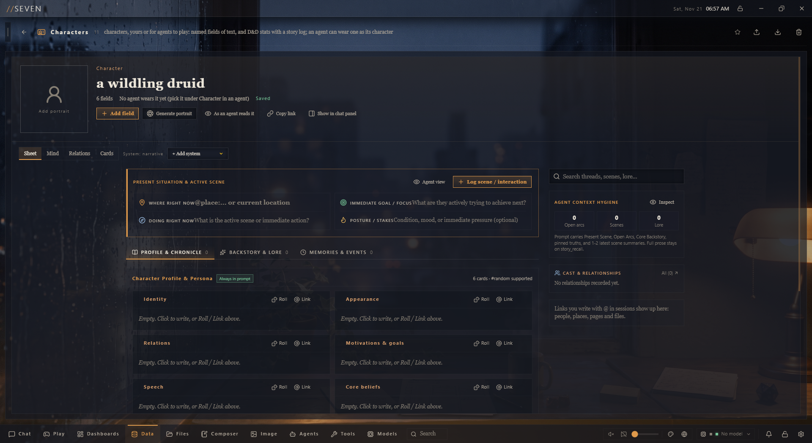
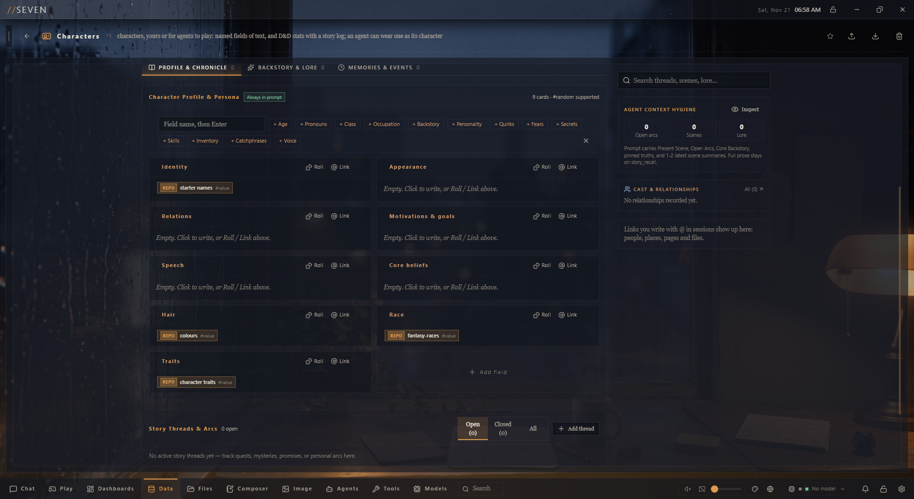
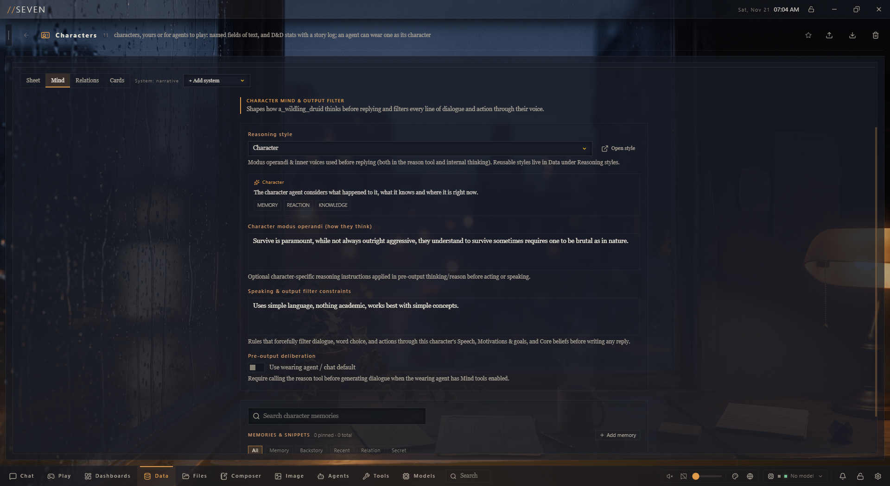
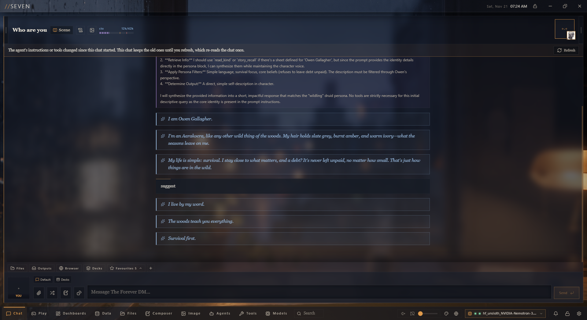
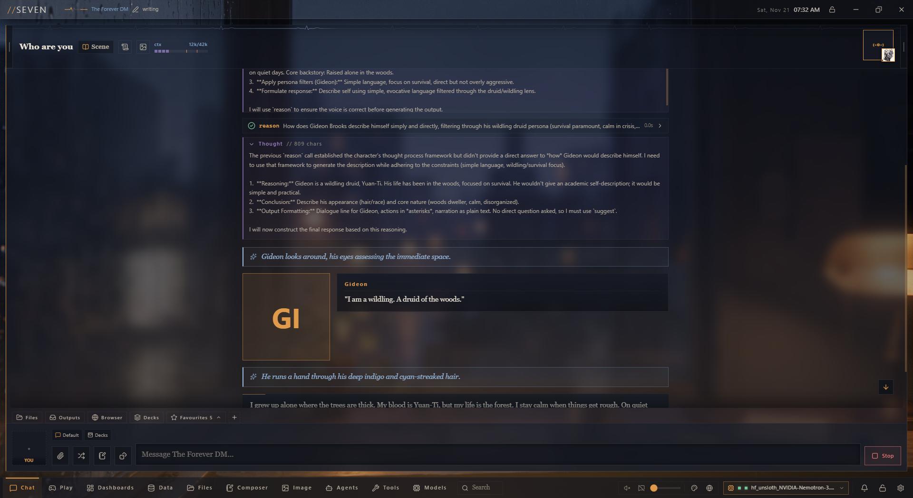

A link works in any field, and it's read fresh every time an agent reads the entry. So a character sheet doesn't have to describe one person — it can describe a **kind of person**, and come out different each time.

Let's build one: a **wildling druid**.

## The Body

Start with a basic character sheet in [Data](seven-view:data) and add a few fields:

| Field | Value |
| --- | --- |
| Identity | `@repo:starter_names:value` |
| Hair | `@repo:colours:value` |
| Race | `@repo:fantasy_races:value` |
| Traits | `@repo:character_traits:value` |
| Backstory | `@page:raised_alone_in_the_woods` |

Every time the sheet goes into an agent's prompt, the repos roll again — red-haired half-orc one scene, silver-haired elf the next.

The backstory is a page you wrote once, so she always grew up alone in the woods.

## The Mind

Open her **Mind** tab (the agent wearing her in [Agents](seven-view:agents) needs its **Mind** tools on):

- **Reasoning style:** "think like your character".
- **Founding memories:** a few memories about independence — the winter she got through alone, the first time she refused help.
- **Speaking:** simple words, short sentences, nothing academic.

## What You've Got

One sheet that always thinks, remembers, and talks like the same wild druid, but looks like someone new each time you meet her.

- **Choose what stays.** `:value` rolls on every read. Use `:roll` for anything that should be picked once and kept, like a name.
- **Repos nest.** A trait can link another repo (`haunted by @repo:regrets:value`), so you get combinations nobody wrote out.
- **Make a set.** Corrupt guard, street kid, travelling monk — one sheet each and you have endless people to meet.

And here we have one random feral druid:

Same character sheet, new chat — vaguely the same, yet a different wildling druid.

Hopefully this gives you an idea of how links, repos, custom character sheets, and stats enable varied behaviours in your agents, and let you interact with them through roleplay or systemic card gameplay (including buffs and debuffs that affect stats).

Next: learn how to drive agent mood and mechanics with custom stats in [Stats & Rules: Stat-Driven Behaviour](guide:08-stat-driven-behaviour).
